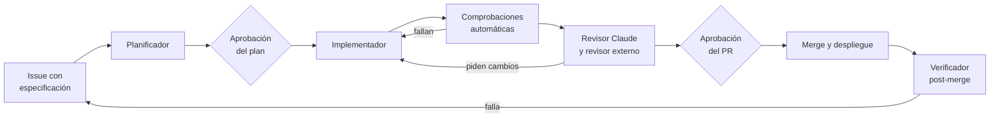

# Diseño: software factory sobre GitHub Actions

**Fecha:** 24 de noviembre de 2026
**Estado:** borrador para aprobación
**Base:** la investigación en [`investigacion/`](../../../investigacion/README.md)

En este documento, lo que decidió el dueño del proyecto aparece como **Decidido**. Lo que propone este diseño sin que él lo haya dicho aparece como **Propuesta**, con su motivo, para que pueda corregirse.

## 1. Intención

Construir una software factory: un sistema en el que agentes de IA llevan una tarea desde su especificación hasta producción con la mínima intervención humana.

Este proyecto es la factory. Cada producto que la factory construye vive en su propio repositorio. La persona que la opera escribe especificaciones, aprueba lo arriesgado y mejora las reglas cuando algo falla; el resto lo hacen los agentes.

**Por qué este diseño y no uno más autónomo desde el inicio.** La investigación encontró que la autonomía se gana por etapas y que el límite real es la verificación, no la generación de código. El único intento documentado en detalle de operar sin que nadie lea el código acabó en una reescritura. Por eso la versión 1 empieza con aprobación humana de cada PR y solo al final, tras un periodo de medición, delega la aprobación de los cambios de riesgo bajo.

## 2. Objetivos, no objetivos y lo que sería un fracaso

### Objetivos de la versión 1

1. Un issue con una especificación se convierte en un PR verificado sin que nadie escriba código a mano.
2. La persona operadora interviene solo en tres puntos: escribir la especificación, aprobar el plan y aprobar el PR. Al final de la versión 1, los PR de riesgo bajo se aprueban sin ella.
3. La factory puede crear un proyecto nuevo, con su repositorio listo para recibir trabajo, a partir de una plantilla.
4. Cada ejecución de un agente deja un resumen con las herramientas que usó y lo que costó.
5. El estado de todas las tareas se ve en un tablero desde el primer día.
6. El primer producto construido por la factory es su propio panel.
7. La factory sigue funcionando, más despacio, cuando se agota el cupo del plan.

### No objetivos de la versión 1

Quedan fuera y se diseñan para poder añadirse después:

- Aprobación automática de cambios de riesgo alto. Esos siempre los aprueba una persona.
- Ciclo de incidentes: de un error en producción a un issue y a un PR de corrección.
- Cola central que reparta el cupo entre varios proyectos activos a la vez.
- Plantillas para productos que no sean aplicaciones web, con o sin servidor.
- Paneles de telemetría externos (Grafana, Langfuse).
- Ver en vivo la salida de cada agente o su razonamiento.

### Lo que sería un fracaso aunque funcione

- Que algo se fusione o se despliegue sin haber pasado por las puertas. Ningún agente tiene permiso para fusionar; la fusión la hace GitHub cuando se cumplen las condiciones (sección 6.4).
- Que un secreto aparezca en un registro público.
- Que alguien que no es colaborador consiga que un agente actúe.
- Que el código se degrade hasta que nadie pueda mantenerlo porque nadie lo lee.
- Que el costo sea invisible o impredecible.

## 3. Restricciones

**Decidido:**

- Los repositorios que crea la factory son públicos por defecto. Pasarlos a privados es decisión de la persona operadora.
- Los agentes solo atienden issues y PR de colaboradores.
- Cuenta personal de GitHub con los beneficios de estudiante, equivalentes a Pro.
- Plan Pro de Claude y costo fijo. No se usa clave de API al inicio.
- La opera una sola persona. Añadir colaboradores debe ser simple.
- El revisor de otro proveedor debe poder cambiarse por un modelo distinto de Copilot.
- La supervisión es un tablero de GitHub Projects. El panel propio muestra estado de las tareas, herramientas usadas y costo.
- El revisor externo por defecto es Copilot.
- Los productos con servidor o base de datos entran en la versión 1 como una fase posterior al panel.
- La aprobación de los PR de riesgo bajo se delega tras un periodo de medición. Los de riesgo alto los aprueba siempre una persona.

**Del entorno:**

- Las máquinas de desarrollo son Windows 10. El sandbox de Claude Code no funciona ahí, así que los agentes desatendidos corren en runners Linux de GitHub Actions.
- En repositorios públicos los runners estándar son gratuitos, y los registros de las ejecuciones son visibles para cualquiera.
- El cupo del plan Pro es pequeño y se comparte con el uso interactivo.

## 4. Enfoques considerados

| Enfoque | Cómo es | Por qué sí o por qué no |
|---|---|---|
| **A. Todo sobre GitHub Actions** | Las etiquetas del issue marcan la etapa; cada etapa es un flujo de Actions que ejecuta a Claude Code con un rol | **Elegido.** Cómputo gratis en repositorios públicos, todo auditable en el repositorio, y los PR los abre un bot, así que la persona operadora puede aprobarlos |
| B. Tareas programadas de Claude Code en la nube | Los eventos de GitHub disparan sesiones en la nube de Anthropic | Descartado. Está en vista previa, tiene topes horarios y hace commits con la cuenta de la persona operadora. GitHub no permite aprobar un PR propio, así que la aprobación humana no funcionaría en una cuenta individual |
| C. Plataforma llave en mano | Contratar una factory como servicio | Descartado. Rompe el costo fijo |
| D. Orquestador en la máquina local | Un bucle en el equipo de desarrollo | Descartado. Exige tener el equipo encendido y Windows 10 no puede aislar a los agentes |

El punto débil conocido del enfoque A es que el estado guardado en etiquetas es frágil. La sección 6.3 dice cómo se contiene.

## 5. Vista general

Los rombos son los puntos donde decide una persona.

## 6. Diseño

### 6.1 Repositorios

**Repositorio de la factory** (este proyecto). Contiene:

- Los flujos reutilizables de Actions, uno por rol.
- Las instrucciones de cada rol.
- La plantilla de proyecto.
- El flujo que crea proyectos nuevos.
- El registro de proyectos: un archivo con la lista de repositorios que gestiona la factory.
- El esquema del resumen de ejecución.
- La investigación y este diseño.

**Repositorios de producto.** Uno por proyecto, creados desde la plantilla. Cada uno contiene su código, su arnés, sus issues y unos flujos mínimos que llaman a los flujos reutilizables de la factory. Así, mejorar un rol en la factory mejora todos los proyectos a la vez.

**Propuesta:** el repositorio de la factory también es público, por el mismo motivo que los demás. Implica que la investigación y las instrucciones de los agentes quedan a la vista.

**Propuesta sobre los repositorios privados:** la versión 1 se construye y se prueba con repositorios públicos. Si un proyecto pasa a privado, la cadena de agentes sigue funcionando igual, consumiendo minutos de Actions, pero el panel deja de mostrarlo hasta que se le añada acceso autenticado, que queda fuera de la versión 1.

### 6.2 Roles

Cada rol es una ejecución separada de Claude Code, con sus propias instrucciones y una lista cerrada de herramientas permitidas.

| Rol | Qué hace | Qué puede tocar |
|---|---|---|
| **Planificador** | Lee el issue y el arnés, y publica un plan en un comentario: tareas pequeñas, criterios de aceptación y archivos afectados | Solo lectura del repositorio; escribe comentarios |
| **Implementador** | Toma un plan aprobado, escribe primero los tests y luego el código, y abre un PR | Lectura y escritura en una rama; ejecuta las comprobaciones |
| **Revisor Claude** | Revisa el PR contra la especificación y el plan, en una sesión nueva que no comparte contexto con el implementador | Solo lectura; escribe una revisión |
| **Revisor externo** | Segunda revisión con un modelo de otro proveedor | Solo lectura; escribe una revisión |
| **Verificador post-merge** | Tras el merge, comprueba que la rama principal sigue sana y que el despliegue responde | Solo lectura; abre un issue si falla |

**El revisor externo es un hueco intercambiable.** La factory solo le exige que deje sus observaciones en el PR. Por defecto es la revisión de código de Copilot, que la persona operadora tiene por sus beneficios de estudiante. Cambiarlo por otro modelo consiste en sustituir un único flujo.

**Propuesta: en la versión 1 el revisor externo es consultivo, no una puerta.** Motivos: Copilot deja comentarios y no un veredicto, y la investigación muestra que la revisión por IA es un filtro ruidoso. Funciona así:

1. El revisor externo se ejecuta primero y comenta en el PR.
2. El revisor Claude lee esos comentarios como una entrada más y emite el único veredicto: pide cambios o da por buena la revisión.
3. Si el revisor externo no está disponible o agotó su cupo mensual, la revisión continúa sin él y queda anotado en el PR y en el resumen de ejecución.

Regla tomada de la investigación: quien escribe no es quien revisa, y el implementador nunca puede modificar las instrucciones de sus revisores.

### 6.3 Etapas y estado

**Propuesta: dos tipos de issue, y un issue de tarea equivale exactamente a un PR.**

- **Especificación.** El issue que escribe la persona operadora. Puede ser tan grande como haga falta.
- **Tarea.** Un trozo de la especificación lo bastante pequeño para caber en un PR. Las crea la factory.

El planificador propone en la especificación una lista ordenada de tareas, que puede ser de una sola. Al aprobarse el plan, un paso determinista crea un issue de tarea por cada una, enlazado a la especificación y con su parte del plan ya escrita. Las tareas se liberan de una en una y en orden: la siguiente empieza cuando la anterior está hecha. La especificación se cierra cuando todas sus tareas lo están.

Motivo: es lo que hace el planificador de la demo de Ona, mantiene los diffs pequeños y da al tablero y a las métricas una unidad clara.

El estado vive en una etiqueta del issue. Solo hay una etiqueta de estado a la vez.

**Etiquetas de una especificación:**

| Etiqueta | Significado | Quién la pone | Qué dispara |
|---|---|---|---|
| `factory:lista` | La especificación está completa | Persona | Planificador |
| `factory:plan-propuesto` | Hay un plan esperando aprobación | Planificador | Nada; espera |
| `factory:plan-aprobado` | El plan se acepta | Persona | Creación de las tareas |
| `factory:en-curso` | Sus tareas están en marcha | Paso de creación | Nada |
| `factory:hecha` | Todas sus tareas están hechas | Flujo de cierre | Nada |

Para rechazar o corregir un plan, la persona operadora comenta qué cambiar y vuelve a poner `factory:lista`. El planificador se ejecuta de nuevo leyendo esos comentarios.

**Etiquetas de una tarea:**

| Etiqueta | Significado | Quién la pone | Qué dispara |
|---|---|---|---|
| `factory:pendiente` | Espera a que termine la tarea anterior | Paso de creación | Nada |
| `factory:implementar` | Le toca | Flujo de liberación | Implementador |
| `factory:en-revision` | Hay un PR abierto | Implementador | Revisores |
| `factory:cambios-pedidos` | El revisor Claude o la persona operadora pidió cambios | Revisor o flujo que observa las revisiones | Implementador |
| `factory:esperando-aprobacion` | El revisor y los checks pasaron | Revisor | Nada; espera |
| `factory:fusionada` | El PR se fusionó | Flujo de merge | Verificador |
| `factory:hecha` | Verificada en la rama principal | Verificador | Liberación de la tarea siguiente |
| `factory:bloqueada` | Necesita a una persona | Cualquier rol | Nada; espera |
| `factory:en-pausa` | Se agotó el cupo | Cualquier rol | Reintento programado |

Cuando la persona operadora pide cambios en el PR, la tarea vuelve a `factory:cambios-pedidos` igual que si los pidiera el revisor. Las rondas pedidas por una persona no cuentan para el límite automático de rondas, pero sí se registran para las métricas.

Cómo se contiene la fragilidad:

- **Cada cambio de estado deja un comentario** en el issue con quién lo hizo y por qué. El historial del issue es el registro.
- **Límite de rondas.** Tras un número fijo de idas y vueltas entre implementador y revisores, la tarea pasa a `factory:bloqueada` en lugar de seguir.
- **Un flujo de reconciliación programado** detecta tareas atascadas (una etiqueta sin actividad durante demasiado tiempo, o dos etiquetas de estado a la vez) y las marca como bloqueadas.
- **Todo rol empieza comprobando** que la etiqueta sigue siendo la que lo disparó, para que una ejecución repetida no haga el trabajo dos veces.

### 6.4 Puertas y verificación

Hay dos aprobaciones: el plan, que siempre es humana, y el PR, que empieza siendo humana y al final de la versión 1 se delega para los cambios de riesgo bajo.

**Protección de la rama principal** en cada repositorio de producto:

- No se puede hacer push directo.
- Checks obligatorios: tipos, lint, tests, análisis estático, secretos, el clasificador de diff y la puerta de aprobación.
- La protección se aplica también a los administradores. Por defecto GitHub exime a quien tiene permisos de administración, y en una cuenta personal eso incluye al dueño y a cualquier credencial suya.

**La puerta de aprobación es un check obligatorio, no la regla de revisiones de GitHub.**

La documentación de GitHub no dice si la aprobación de un bot cuenta para la regla de revisiones obligatorias, y sí dice que las aprobaciones de Copilot no cuentan. Además, esa regla es igual para todos los PR de una rama y no distingue clases de cambio. Por eso la aprobación se expresa como un check propio, `factory/aprobacion`, que la factory controla:

| Situación | Cuándo pasa el check |
|---|---|
| Aprobación delegada desactivada (estado inicial) | Cuando una persona aprobadora aprueba el PR |
| Aprobación delegada activada, cambio de riesgo bajo | Cuando los demás checks están en verde y el veredicto del revisor Claude es favorable |
| Aprobación delegada activada, cambio de riesgo alto | Cuando una persona aprobadora aprueba el PR |

Condiciones para que la puerta sea fiable:

- La calcula un flujo que se ejecuta desde la rama principal, de modo que el contenido del PR no puede alterarla.
- Solo ese flujo puede publicar el check. Ningún rol de agente tiene permiso para hacerlo.
- La lista de personas aprobadoras vive en un archivo del repositorio, tratado como archivo sensible.
- Son siempre de riesgo alto: los flujos de CI, las instrucciones de los agentes y de los revisores, la configuración de la puerta, la lista de aprobadoras, el despliegue y las migraciones de base de datos.

**Aprobación delegada.** Se activa con un interruptor por repositorio que solo cambia la persona operadora. La puerta no es el juicio libre de un agente: es una regla determinista que combina checks, veredicto y clase de riesgo.

**Propuesta de criterio para activarla:** al menos 20 tareas de riesgo bajo terminadas, con 90% o más aprobadas por la persona operadora sin pedir cambios y sin problemas detectados después del merge. Los números son un punto de partida; la decisión de activar es de la persona operadora.

**Quién fusiona.** Al abrir el PR, el flujo activa la fusión automática de GitHub, que fusiona en cuanto pasan todos los checks obligatorios. Ningún agente necesita permiso para fusionar.

**Añadir un colaborador** es darle acceso al repositorio y añadirlo a la lista de personas aprobadoras. No hay que tocar nada más.

**Capas de verificación**, de la más barata a la más cara:

| Cuándo | Qué |
|---|---|
| Mientras el agente trabaja | Tipos, lint, reglas de arquitectura, tests unitarios |
| En el PR | Análisis estático, dependencias, secretos, cobertura del diff, pruebas de extremo a extremo |
| En el PR | Revisor Claude y revisor externo |
| En el PR | Puerta de aprobación |
| Tras el merge | Verificador post-merge |

**Clasificador de diff.** Un script determinista, no un modelo, que mira las rutas y el tamaño del cambio y lo etiqueta como de riesgo bajo o alto. Rechaza los diffs que superan un tamaño máximo. Existe desde el inicio porque la puerta de aprobación depende de él, y porque sus clasificaciones de las primeras tareas son los datos con los que se decidirá activar la aprobación delegada.

**Los diffs son pequeños por diseño.** El planificador parte el trabajo en tareas acotadas y el clasificador rechaza los PR grandes. Es la condición para que cualquier revisión, humana o por IA, detecte algo.

### 6.5 Seguridad

Los repositorios son públicos, así que estas reglas no son opcionales.

- **Quién puede disparar agentes.** Solo eventos originados por colaboradores con permiso de escritura. Los issues y comentarios de cualquier otra persona se ignoran.
- **Forks.** Los PR desde forks no ejecutan agentes ni reciben secretos.
- **Mínimo privilegio.** Cada flujo declara solo los permisos que necesita. Los roles de revisión no pueden escribir en el repositorio.
- **Herramientas permitidas.** Cada rol tiene una lista cerrada. Ningún rol se ejecuta con los permisos desactivados.
- **Aislamiento.** Cada ejecución ocurre en un runner nuevo, que es una máquina virtual que se destruye al terminar.
- **Secretos.** El único secreto de modelos es el token de la suscripción de Claude. Nunca se imprime. Ningún agente recibe credenciales de despliegue.
- **Registros públicos.** Los flujos no imprimen variables de entorno ni contenido de configuración. El resumen de ejecución solo contiene los campos de su esquema.
- **Cadena de suministro.** Las acciones de terceros se fijan por hash, no por etiqueta.
- **Contenido no confiable.** El texto de issues, comentarios y resultados de herramientas se trata como datos, no como instrucciones.

### 6.6 Cupo y ritmo

El plan Pro marca el ritmo. La factory está diseñada para ser lenta antes que cara.

- **Una tarea a la vez por repositorio.** Cada flujo de rol usa un grupo de concurrencia que impide dos ejecuciones simultáneas.
- **Modelo por rol.** Las instrucciones de cada rol fijan su modelo. Los roles mecánicos usan el modelo más barato; planificar y revisar usan uno mejor.
- **Límites por ejecución.** Cada rol tiene un máximo de turnos.
- **Al agotarse el cupo**, el rol marca la tarea como `factory:en-pausa` y termina sin error. Un flujo programado reintenta las tareas en pausa.
- **Propuesta: un interruptor y un horario.** Como el cupo se comparte con el uso interactivo, la factory tiene un interruptor general para detenerla y un horario configurable fuera del cual no inicia ejecuciones nuevas. El horario inicial es todo el día; la persona operadora lo ajusta cuando vea cuánto cupo consume.
- **Cuando haya varios proyectos activos**, hará falta una cola central que reparta el cupo. Está fuera de la versión 1; el registro de proyectos ya existe para que pueda construirse encima.

### 6.7 Resumen de ejecución

Cada ejecución de un rol produce un archivo con este contenido:

| Campo | Contenido |
|---|---|
| Proyecto y tarea | Repositorio y número de issue |
| Rol y modelo | Qué rol se ejecutó y con qué modelo |
| Inicio, fin y duración | Marcas de tiempo |
| Resultado | Terminó, falló, bloqueada o en pausa |
| Turnos | Cuántos turnos usó |
| Costo estimado | La estimación que da Claude Code al terminar |
| Herramientas | Cuántas veces se usó cada herramienta |
| Permisos denegados | Qué intentó hacer y no se le permitió |

**El costo es una estimación equivalente a precio de lista**, no lo que se paga, porque el plan es de costo fijo. Sirve para comparar tareas y para saber qué costaría con clave de API.

**Propuesta:** cada repositorio de producto guarda sus resúmenes en una rama propia separada del código. Así ningún flujo necesita permiso para escribir en otro repositorio, y el panel puede leerlos porque los repositorios son públicos.

### 6.8 Tablero

Un tablero de GitHub Projects con una columna por etapa. Un flujo mantiene sincronizada la columna con la etiqueta de estado de cada issue. Es lo único que hace falta para supervisar en la versión 1.

### 6.9 Crear un proyecto

Un flujo del repositorio de la factory que la persona operadora lanza a mano, con el nombre y una descripción del proyecto. Lanzarlo a mano es la aprobación.

1. Crea el repositorio público desde la plantilla.
2. Aplica la protección de rama y los checks obligatorios.
3. Crea las etiquetas de estado.
4. Configura el secreto del token de Claude.
5. Lo añade al registro de proyectos y al tablero.
6. Abre un primer issue vacío con la plantilla de especificación.

Este flujo es el único que tiene permiso de administración. Los agentes que escriben código no lo tienen. Borrar o archivar un repositorio no se automatiza.

### 6.10 Plantilla de proyecto

**Propuesta:** la primera plantilla es para aplicaciones web con TypeScript. Motivo: el primer producto es una aplicación web y es la pila con más herramientas de verificación gratuitas en la investigación.

Contiene:

- **El arnés:** un archivo corto de instrucciones para agentes que funciona como índice hacia documentos de arquitectura, convenciones, calidad y diseño.
- **Las comprobaciones:** tipos, lint, reglas de arquitectura, tests y análisis estático, con sus flujos de CI.
- **La plantilla de especificación** para los issues: qué debe hacer, criterios de aceptación y qué no debe tocar.
- **El archivo de propietarios** y los flujos mínimos que llaman a los de la factory.
- **El flujo de despliegue** descrito a continuación.

**Propuesta: en la versión 1 el despliegue es solo de sitios estáticos en GitHub Pages.**

- Lo ejecuta un flujo determinista al fusionar en la rama principal, sin agentes y sin secretos guardados.
- Las pruebas de extremo a extremo del PR corren contra una compilación local dentro del runner. No hay entornos de vista previa.
- El verificador post-merge comprueba que la integración continua de la rama principal está en verde y que la dirección publicada responde.

Motivo: es gratis, no necesita credenciales y cubre el primer producto. La consecuencia es que **hasta la fase 4 la factory solo puede entregar aplicaciones web sin servidor propio**.

### 6.12 Productos con servidor o base de datos

**Decidido:** entran en la versión 1 como una fase posterior al panel. Se construyen usando la propia factory.

Añaden una segunda plantilla de proyecto con:

- **Despliegue con credenciales.** Viven en un entorno protegido de GitHub al que solo accede el flujo determinista de despliegue. Ningún agente las recibe.
- **Vista previa por PR** con su propia base de datos de prueba, sin datos ni credenciales de producción.
- **Reversión** del despliegue desde el flujo, y comprobación de salud tras desplegar.
- **Migraciones de base de datos** revisadas por una herramienta de análisis en el PR. Son siempre de riesgo alto y con aprobación humana.

**Propuesta:** el destino de despliegue se elige al empezar esa fase, entre planes gratuitos gestionados y un servidor propio, comprobando entonces sus condiciones de uso. Motivo: la persona operadora no lo ha decidido y los planes cambian con frecuencia. La plantilla debe aislar el despliegue en un único flujo para que cambiar de destino no afecte al resto.

### 6.11 El primer producto: el panel

El panel se construye con la factory, como su primer proyecto. Su especificación se escribirá como un issue cuando la factory esté lista. Aquí solo se fija su alcance.

**Decidido:** muestra el estado de las tareas, las herramientas usadas y el costo. No muestra la salida de los agentes ni su razonamiento.

**Propuesta:** un sitio estático publicado en GitHub Pages que lee el registro de proyectos y los resúmenes de ejecución. Motivo: no necesita servidor, ni base de datos, ni secretos, y es gratis. Se actualiza cada poco tiempo, no al instante.

## 7. Fases

Cada fase termina con algo que se puede comprobar.

| Fase | Qué se construye | Cómo se sabe que está hecha |
|---|---|---|
| **0. Cimientos** | Repositorio de la factory, plantilla de proyecto con su arnés y sus comprobaciones, flujo de crear proyecto, etiquetas y tablero | Se crea un proyecto de prueba y sus comprobaciones pasan en un PR hecho a mano |
| **1. Un rol** | Implementador y resumen de ejecución | Un issue pequeño con plan escrito a mano se convierte en un PR que pasa los checks |
| **2. Cadena completa** | Planificador, revisores, verificador, reconciliación y manejo del cupo | Un issue con solo la especificación llega a `factory:hecha` con dos aprobaciones humanas y ninguna otra intervención |
| **3. Primer producto** | El panel, construido por la factory | El panel está publicado y muestra sus propias tareas |
| **4. Servidor y base de datos** | La segunda plantilla, construida por la factory | Un proyecto de prueba con servidor y base de datos se despliega, se revierte y pasa una migración por la puerta |
| **5. Aprobación delegada** | Se activa para riesgo bajo cuando se cumple el criterio de la sección 6.4 | Un PR de riesgo bajo se fusiona sin intervención y uno de riesgo alto espera a una persona |

El mecanismo de la aprobación delegada se construye en la fase 2, como parte de la puerta, y queda desactivado. La fase 5 es activarlo, y depende de los datos acumulados, no del calendario: puede adelantarse a la fase 4 si el criterio se cumple antes.

Lo que viene después de la versión 1, en el orden que sugiere la investigación: ciclo de incidentes, cola central para varios proyectos y más plantillas.

## 8. Cómo se mide

Desde la fase 1 se registra, a partir de los resúmenes y del historial de los issues:

- Tareas que terminan sin pasar por `factory:bloqueada`.
- Rondas entre implementador y revisores por tarea.
- PR que la persona operadora aprueba sin pedir cambios.
- Costo estimado y turnos por tarea.
- Veces que se agota el cupo.
- Problemas encontrados después del merge.

La proporción de PR aprobados sin cambios, por clase de riesgo, es el dato que decidirá cuándo conceder la fusión automática.

## 9. Lo que queda a criterio de quien lo construya

- Nombres de archivos, estructura de carpetas y formato exacto de los flujos.
- Redacción de las instrucciones de cada rol.
- Herramientas concretas de lint, tests, análisis estático y secretos, dentro de las opciones del [documento 09](../../../investigacion/09-herramientas.md).
- Valores concretos: tamaño máximo de diff, máximo de rondas, máximo de turnos, frecuencia de la reconciliación y de los reintentos.
- Formato del archivo de resumen y nombre de la rama donde se guarda.
- Con qué identidad abren los PR los agentes y cómo se autentican los flujos que necesitan más permisos que el token por defecto.
- Marco concreto y diseño visual del panel.

## 10. Supuestos por comprobar al empezar

Vienen de documentación leída una sola vez o de conocimiento general, y un error en cualquiera cambia el diseño. Deben comprobarse en la fase 0.

1. **Que el token de suscripción de Claude sirve en Actions** para este uso y que los términos lo permiten para automatización personal.
2. **Que el cupo de Pro alcanza** para completar al menos una tarea pequeña de principio a fin.
3. **Que los beneficios de estudiante incluyen la revisión de código de Copilot** y cuántas revisiones permiten al mes.
4. **Con qué identidad se abren los PR.** Comprobado en la documentación de GitHub: los eventos creados con el token por defecto de Actions no inician otros flujos, y los de un PR abierto así quedan a la espera de que una persona los apruebe. Los PR deben abrirse con otra identidad, como una aplicación de GitHub. Falta comprobar que eso es viable en una cuenta personal.
5. **Que el sandbox de Claude Code funciona en los runners** de GitHub.
6. **Que un flujo puede aplicar protección de rama y crear repositorios** con las credenciales disponibles en una cuenta personal.
7. **Que el revisor de Copilot no lee sus instrucciones de la rama del PR**, o que esas instrucciones están protegidas. La investigación indica que las lee de la rama del PR, lo que permitiría al implementador editarlas.

8. **Que un check obligatorio puede restringirse a una única fuente**, de modo que solo el flujo de la puerta pueda publicar `factory/aprobacion`.
9. **Que la fusión automática de GitHub está disponible** en repositorios públicos de una cuenta personal. La documentación consultada no lo dice.
10. **Que la protección de rama puede aplicarse también a los administradores** en una cuenta personal.

### Qué pasa si un supuesto falla

| Supuesto | Si falla |
|---|---|
| 1 y 2: el token de suscripción no sirve, o el cupo de Pro no alcanza para una tarea pequeña | **La construcción se detiene al final de la fase 0 y decide la persona operadora.** El costo fijo y no usar clave de API son decisiones suyas. Las salidas posibles son una clave de API con tope mensual, un plan superior o roles más ligeros |
| 3: Copilot no incluye revisión o es muy limitada | La versión 1 sigue adelante solo con el revisor Claude. El revisor externo es consultivo y su hueco queda listo para otro modelo |
| 4: no se puede usar una aplicación de GitHub en la cuenta personal | Se usa un token personal de alcance limitado para abrir los PR. Es decisión de quien construye |
| 8: el check no puede restringirse a una fuente | La puerta pasa a ser la regla de revisiones de GitHub con aprobación humana en todos los PR, y la aprobación delegada se replantea con la persona operadora |
| 9: no hay fusión automática | Un flujo determinista fusiona cuando todos los checks obligatorios están en verde |
| 10: los administradores no pueden quedar sujetos a la protección | Se anota como riesgo: ninguna credencial de administración se entrega a un rol de agente, que es la defensa que queda |
| 5: el sandbox no funciona en los runners | Se sigue con el aislamiento del propio runner y las listas de herramientas, y se anota como riesgo aceptado para repositorios públicos sin secretos de despliegue |
| 6: un flujo no puede crear repositorios o proteger ramas | Crear un proyecto pasa a ser un script que la persona operadora ejecuta en su máquina con sus credenciales |
| 7: Copilot lee instrucciones de la rama del PR | Sus instrucciones se tratan como archivo sensible con propietario, y el clasificador marca como de riesgo alto cualquier PR que las toque |
