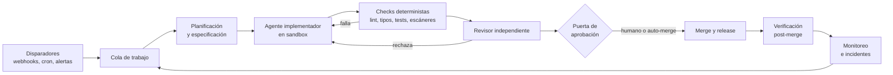

# 02 · Arquitectura de referencia

Este documento reúne los patrones de arquitectura que describen las fuentes. Las marcas [V], [C], [E], [R] e [I] se explican en el [README](README.md). La mayor parte se contrastó en una segunda pasada contra las fuentes originales [C], con las correcciones ya aplicadas.

## Flujo general

Las fuentes coinciden en un mismo esqueleto [V, hallazgo 3]:

El ciclo se cierra: los incidentes de producción vuelven a la cola como trabajo nuevo.

## Etapas del pipeline según cada fuente

| Fuente | Estructura | Dónde queda la persona |
|---|---|---|
| O'Reilly, "Inside a Software Factory", de Paul Iusztin [C] | 8 etapas en 3 bloques. *Qué construir:* triaje, ideación, planificación. *Construir y comprobar:* implementación, revisión, revisión en CI, release. *Mejora continua:* monitoreo y respuesta a incidentes. Una capa de contexto (por ejemplo una wiki para el modelo) atraviesa todas | En ideación y planificación, en la revisión y merge del PR, y en las comprobaciones humanas de despliegue durante el release |
| Qodo [C] | 6 etapas: entrada, plan, implementación, comprobación independiente, aprobación con criterio, aprendizaje desde producción. 6 componentes: intención, agentes, sandbox, verificación, criterio humano, medición | En cuatro casos: criterio de producto, riesgo nuevo sin comprobación barata, rutas sensibles como pagos o autenticación, y excepciones de política |
| Ona [V] | 16 automatizaciones. En su texto de la primera semana las agrupa en cinco capas: planificación, construcción, calidad, verificación y operación [C] | Specs, configuración y escalamientos |
| Vercel [V] | 4 responsabilidades: agente de código, checks de CI, capa de coordinación, mantenedor | Autoridad de merge |
| Fábrica de un solo autor, O'Reilly [C] | Por historia: tests primero, construcción, puerta de cobertura, agente revisor, merge. Hasta 5 historias en paralelo en worktrees de git aislados | Redacta épicas e historias en sesiones interactivas con el modelo. El artículo no describe revisión humana de PR |

Sobre el peso de estas fuentes [C]: el esquema de O'Reilly es el marco personal de un practicante que trabaja mayormente solo, no un estándar de la industria. El autor cuenta que su primera versión estaba tan sobredimensionada que dejó de usarla. El de Qodo es una entrada de glosario de un proveedor, sin autor ni fecha, que aclara que "dark" no significa sin personas.

Dos observaciones útiles para el plan:

- **Planificación y operación pesan más que construcción.** En el caso de Ona, esas fases necesitaron más automatizaciones que construir y revisar [E; el dato viene de un resumen de sus retransmisiones en vídeo, que no se pudieron leer].
- **Separar al que escribe del que evalúa.** Un agente que evalúa su propio trabajo tiende a favorecerlo, por lo que la implementación y el control de calidad deben ser agentes distintos [C, O'Reilly, que atribuye la idea a Addy Osmani]. Coincide con el resultado verificado de que añadir un verificador del objetivo mejora el éxito [V, hallazgo 8].

## El arnés (harness)

El arnés es todo lo que rodea al modelo: instrucciones, documentos, herramientas, reglas y comprobaciones [C, Birgitta Böckeler en martinfowler.com]. La autora recoge esa definición amplia como uso común y se centra en el arnés exterior: el que construye el equipo alrededor de un agente que ya trae el suyo.

### Guías y sensores

- **Guías (antes de actuar):** documentos e instrucciones que orientan al agente.
- **Sensores (después de actuar):** comprobaciones que observan el resultado y permiten la autocorrección.

Hacen falta ambos. Un agente solo con sensores repite errores; uno solo con guías nunca comprueba que las reglas funcionaron [C].

### Controles computacionales e inferenciales

| Tipo | Ejemplos | Costo | Dónde usarlos |
|---|---|---|---|
| Computacionales (deterministas) | Linters, verificación de tipos, tests, análisis estructural | Bajo y rápido | En cada cambio, dentro del ciclo del agente |
| Inferenciales (basados en modelo) | Revisión de código por un agente, juicio semántico | Alto y no determinista | Donde hace falta criterio |

Fuente: Birgitta Böckeler, martinfowler.com [C]. La distinción aplica tanto a guías como a sensores.

### Qué contiene el arnés en los casos publicados

**Ona** [V]: `AGENTS.md`, `architecture.md`, `design.md`, `conventions.md`, `quality.md`, spec de producto y Storybook como referencia visual.

**OpenAI, experimento con Codex** [C, contrastado con el artículo original y con una charla posterior del mismo autor]:

- Un único archivo grande de instrucciones fracasó: desplazaba la tarea, se quedaba obsoleto y era difícil de comprobar mecánicamente.
- Lo sustituyó un `AGENTS.md` de unas 100 líneas que funciona como mapa hacia un directorio `docs/` estructurado y versionado, tratado como sistema de registro. Linters, trabajos de CI y un agente dedicado comprueban que la documentación siga vigente.
- Arquitectura por capas fija dentro de cada dominio de negocio (tipos, configuración, repositorio, servicio, runtime, interfaz), impuesta por linters a medida que el propio agente generó y por tests estructurales.
- Límites de tamaño de archivo impuestos por lints. El límite de 350 líneas es un ejemplo que el autor da en la charla.
- "Un solo ORM, un solo lenguaje" son recomendaciones del autor en la charla, no una descripción documentada del repositorio.
- El equipo concentra su trabajo en unas 5 a 10 skills centrales (unas seis, según un pódcast).

**Uber** [C]: más de 3,600 skills a lo largo del ciclo de desarrollo, ejecutadas más de 30,000 veces al día.

**Afirmación refutada [R].** La primera versión de este informe decía que OpenAI probó miles de skills y las consolidó. No es así: el contraste con "miles" lo planteó el moderador de la charla. No hay contradicción con Uber; son un equipo pequeño con pocas skills centrales y una organización grande con un catálogo amplio.

Construir el arnés es una práctica continua, no una configuración inicial. Los repositorios con código legado son los más difíciles de equipar, justo donde más falta hace; los proyectos nuevos pueden diseñarse desde el primer día para ser fáciles de equipar [C, Birgitta Böckeler].

## Coordinación entre agentes

- **La coordinación plana entre pares colapsa** [C, Cursor]. En su experimento de construir un navegador, 20 agentes que se coordinaban mediante un archivo de estado compartido rindieron como 1 a 3, sobre todo por la contención de bloqueos.
- **La jerarquía funciona mejor** [C, Cursor]. Planificador, subplanificadores y trabajadores de forma recursiva, cada trabajador con su propia copia del repositorio. Un único integrador se eliminó porque se volvió cuello de botella. Exigir que cada commit fuera correcto serializaba el trabajo; aceptaron una tasa de error pequeña y estable, seguida de una pasada final de reconciliación hasta dejar la rama en verde. Escala del experimento: alrededor de una semana, con cientos de agentes concurrentes.
- **Agentes pequeños y enfocados** [C, corregido]. La guía original, de los "12-Factor Agents" de HumanLayer, recomienda acotar cada agente a un dominio con 3 a 10 pasos y 20 como máximo. Es una recomendación de diseño, no un límite medido de coherencia.
- **Roles estrechos y terminación explícita.** Los modos de fallo más frecuentes en sistemas multi-agente son la repetición de pasos y no saber cuándo terminar [V, hallazgo 8].
- **Ejecución serial con paralelización dirigida.** Es lo que mejor le ha funcionado a Factory, que lo deja como pregunta abierta [C].
- **Conflictos de merge.** Con varios PR por ingeniero al día, los conflictos fueron graves al principio en el equipo de OpenAI [E].

## Estado, reintentos y trazabilidad

- **El trabajo se representa como issues.** El planificador de Ona crea issues de GitHub secuenciales, con criterios de aceptación y cadenas de dependencia [C]. Que los issues fueran la única fuente de verdad en lugar de archivos markdown solo aparece en un resumen de terceros [E].
- **Tareas idempotentes y reanudables.** Cada tarea lleva un identificador estable, las acciones completadas se registran al momento, los reintentos comprueban primero si ya existe el resultado y los resultados de tests se asocian a una revisión concreta, para que una ejecución reanudada no atribuya un resultado viejo a un parche nuevo [C, Vercel; "idempotente" es etiqueta de esta investigación]. Vercel distingue los fallos transitorios, que se reintentan, de las instrucciones ambiguas, que necesitan el criterio de un responsable.
- **Criterio de aceptación explícito.** Un build en verde aporta evidencia, pero no decide si el comportamiento pedido es el deseado. Cada flujo necesita un punto final definido (PR en borrador, parche aceptado o despliegue) y una decisión de aceptación que quede registrada [C, Vercel].
- **Limpieza recurrente** [C, OpenAI]. El equipo dedicaba todos los viernes, el 20% de la semana, a limpiar residuos generados por agentes. No escalaba. Lo sustituyeron por principios codificados en el repositorio y tareas recurrentes en segundo plano que abren PR de refactorización; la mayoría se revisa en menos de un minuto y se fusiona automáticamente.
- **Agentes revisores en cada push** [C, OpenAI]. Agentes de revisión de seguridad y fiabilidad se ejecutan en CI con cada push y solo señalan los problemas que bloquearían el merge.

## Espectro de autonomía

| Nivel | Descripción | Ejemplos citados |
|---|---|---|
| Asistido | Agentes y skills para tareas acotadas y medibles | Punto de entrada según Factory [V] |
| Automatizaciones recurrentes | Agentes con disparador y memoria que hacen una tarea estrecha | Ona [V], cron nocturno de Osmani [E] |
| Factory con merge humano | Los agentes llegan hasta el PR; una persona aprueba | Vercel [V], O'Reilly [C], PostHog (agentes abren el 70% de los PR de su monorepo) [C] |
| Factory con auto-merge por clase de cambio | Fusión automática donde la verificación es barata y el impacto pequeño | Ona en su demo [V], pronóstico de Qodo [C] |
| "Dark factory" | Nadie lee el código; las personas definen intención y revisan resultados | StrongDM [C] |

### La "dark factory"

**Origen del término** [C]. Dan Shapiro propuso en enero de 2026 una escala de seis niveles, del 0 al 5, inspirada en los niveles de conducción autónoma. En el nivel 3 el desarrollador pasa a gestionar y revisar código de IA, y según él casi todos se quedan ahí. En el nivel 4 escribe specs y planes y el agente trabaja largos tramos. El nivel 5 es la dark factory: una caja negra que convierte specs en software.

**StrongDM** [C, contrastado con su propia página]:

- Dos reglas: las personas no escriben el código y tampoco lo revisan.
- Valida con un "universo gemelo digital": clones de comportamiento de seis servicios de terceros de los que depende su software. Ejecuta miles de escenarios por hora.
- Los escenarios son historias de usuario de extremo a extremo, a menudo guardadas fuera del código, y se mide una métrica de satisfacción.
- Es un equipo de tres ingenieros que empezó en julio de 2025, según un análisis de Stanford.
- Ese mismo análisis plantea dudas de confianza, de circularidad (una IA juzgando a otra) y de responsabilidad.

**Condiciones previas según PostHog** [C]: adopción alta de IA en el equipo; salida de los agentes validada hasta dejarla fusionable mediante revisión por pares, pruebas locales o recorridos en navegador (los tests unitarios y el razonamiento del propio agente no bastan); y salvaguardas que den por hecho el fallo, con personas decidiendo solo en los PR de alto riesgo.

**Límites.** Los ejemplos creíbles son equipos muy pequeños y su viabilidad a escala empresarial no está demostrada, a juicio de Tessl [C]. Existe un caso de fracaso documentado por su propio protagonista, descrito en el [documento 06](06-limites-y-riesgos.md).

## Criterios de diseño a evaluar

Los tres requisitos de Factory [V, confianza baja, hallazgo 4]: independencia de modelo, despliegue controlado por el dueño e instrumentación de cada etapa para que unas alimenten a otras.
